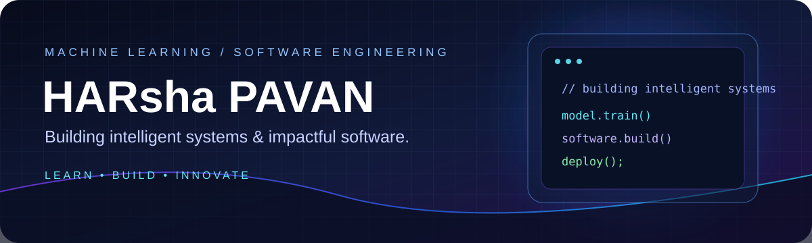

<!-- Glossy portfolio README | github.com/Harsha-2005 -->

  

 

---

<table>
<tr>
<td width="68%" valign="middle">

## Hey, I'm Harsha Pavan

**Computer Science Undergraduate · Aspiring Machine Learning Engineer · Software Developer**

I’m pursuing B.Tech in Computer Science at **Lovely Professional University (2027)**, with a minor in **Machine Learning**.

I work at the intersection of **AI/ML and software engineering** — learning how models work, experimenting with data-driven approaches, and building backend systems and applications that turn ideas into useful products.

- Exploring machine learning, deep learning, NLP and intelligent agents.
- Building backend applications and APIs with Java, Spring Boot and FastAPI.
- Strengthening DSA, software design and core computer science fundamentals.
- Interested in engineering practical, reliable AI-powered products.

</td>
<td width="32%" align="center" valign="middle">
  
   
  <b>PIXEL MODE: ON</b>
   
  Learning. Building. Iterating.
</td>
</tr>
</table>

## ✦ My focus

<table>
<tr>
<td width="50%" valign="top">

### 

- Machine Learning & model evaluation
- Deep Learning with PyTorch / TensorFlow
- NLP and language-model applications
- Agent environments and applied AI

</td>
<td width="50%" valign="top">

### 

- Java and Spring Boot backend development
- REST APIs and database integration
- Data Structures & Algorithms
- Building maintainable end-to-end applications

</td>
</tr>
</table>

## ⚡ Tech stack

**LANGUAGES**

**AI / MACHINE LEARNING**

**BACKEND / TOOLS**

<b>More tools and technologies</b>

 
Keras · Spring Data JPA · Streamlit · Jupyter Notebook · Google Colab

## 🚀 Selected projects

<table>
<tr>
<td width="50%" valign="top">

### 🧪 OpenEnv Data Pipeline Debugger

An OpenEnv/Gym-style environment for training and evaluating autonomous agents on data-pipeline debugging and repair.

- Structured action space for pipeline inspection and repair.
- Tiered difficulty and seeded bug injection.
- Reward shaping for repair decisions and validation.

**Area:** Agent learning · Data engineering · RL-style evaluation

</td>
<td width="50%" valign="top">

### 🔍 AI TraceFinder

An AI-assisted media-analysis project exploring image-forensics techniques and machine-learning models.

- Next.js frontend and FastAPI backend.
- Image-analysis pipeline using forensic features and ML models.

**Area:** Computer vision · Image forensics · Full-stack AI

</td>
</tr>
<tr>
<td width="50%" valign="top">

### 📈 SKAB IIoT Predictive Maintenance

A machine-learning project exploring anomaly detection for industrial sensor data using Isolation Forest, One-Class SVM and LSTM autoencoders.

**Area:** Time series · Anomaly detection · Predictive maintenance

</td>
<td width="50%" valign="top">

### 📊 AI Stock Market Sentiment Analyzer

A sentiment-analysis application combining FinBERT with deep-learning experiments and technical features.

**Area:** NLP · FinBERT · PyTorch · Streamlit

</td>
</tr>
<tr>
<td colspan="2" valign="top">

### 📦 Warehouse Management System

A Java and Spring Boot application applying backend layering, persistence and database-integration concepts.

[Explore repository](https://github.com/Harsha-2005/warehousemanagement)

</td>
</tr>
</table>

  

## 💼 Experience

**Technical Support Intern — Data Centre, Lovely Professional University**  
*January 2025 – May 2025*

- Supported 200+ student Wi-Fi connectivity, authentication and network-performance issues.
- Troubleshot network problems using `ping`, `tracert`, `ipconfig` and `nslookup`.
- Applied practical knowledge of TCP/IP, DNS, DHCP and WLAN fundamentals.

## 📊 GitHub activity

 

 

## 🧭 What I'm focused on now

- Deepening ML and deep-learning fundamentals through implementation.
- Improving problem-solving and DSA consistency.
- Building backend services with Java, Spring Boot and database integration.
- Learning to take AI/ML experiments toward reliable, usable applications.

## 🤝 Connect with me

  

**LEARN&nbsp; · &nbsp;BUILD&nbsp; · &nbsp;INNOVATE**

